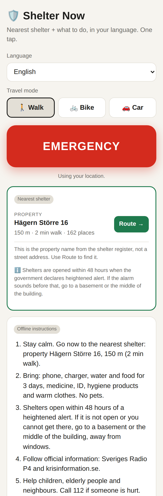
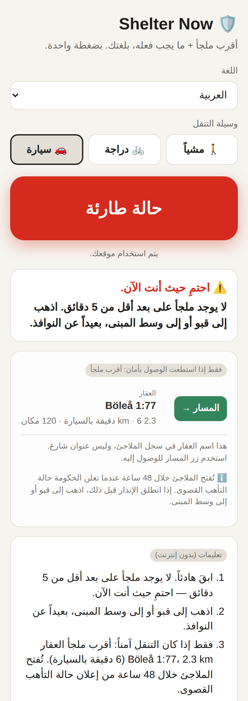
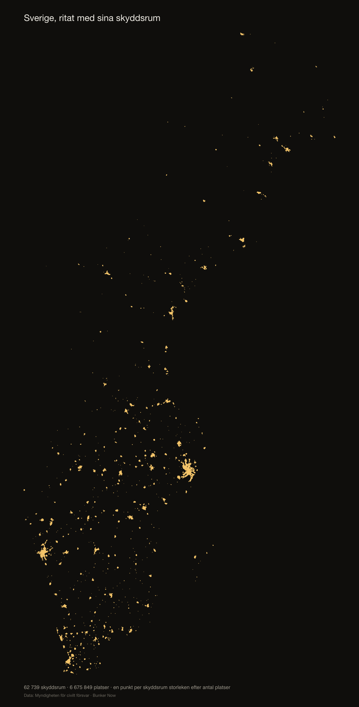
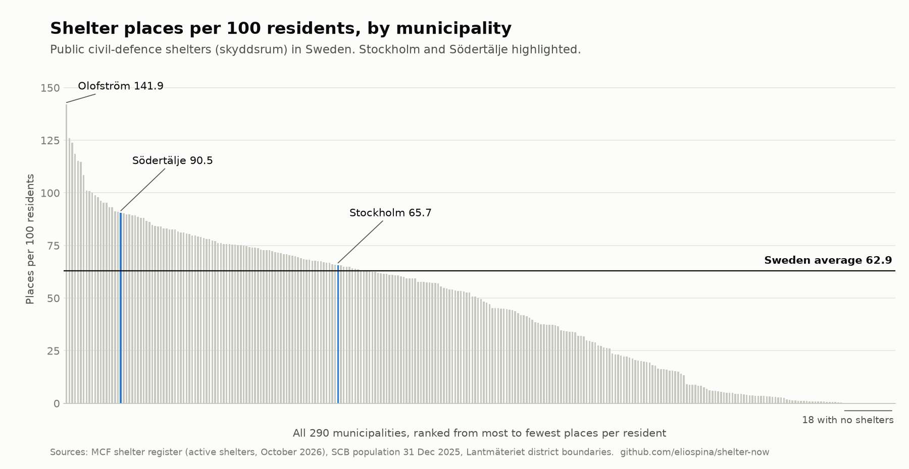

# 🛡️ Bunker Now

**Live app: [shelter-now-eta.vercel.app](https://shelter-now-eta.vercel.app)** · Built with Claude and Claude Code at Claude Build Day Stockholm, September 2026.

**One tap shows the nearest of Sweden's 62,761 public shelters, how to get
there, and what to do, in your language.**

Around 2 million people in Sweden were born abroad. Many have never heard the
word *skyddsrum* and don't know what the alarms mean. In a crisis, everyone
should know what to do, whatever language they speak.

<p align="center">
  
  &nbsp;&nbsp;
  
</p>

## What it does

- 🔴 **One EMERGENCY button** uses your location to find the 3 nearest shelters.
- 📴 **Works without internet (Android app):** all 62,761 shelters are inside the app and the nearest is found on the phone, with built-in instructions in every language. GPS needs no internet.
- 🧭 **A compass to the shelter:** an arrow, the live distance and the direction ("8.9 km · north"), from GPS and the phone's compass, for when maps won't load.
- 🚶🚲🚗 **Walking, cycling or driving:** travel time and a Google Maps route for each mode.
- ⚠️ **Take cover first when a shelter is too far.** If the nearest shelter is more than 5 minutes away (about 400 m on foot), the app tells you to go to a basement or the middle of the building, and shows the shelter only as a second option.
- 📝 **Calm, numbered instructions** written by Claude in your language, limited to official MCF and Krisinformation guidance. If Claude can't answer, built-in instructions appear instead, so the button always works.
- 🌍 **7 languages:** Swedish, English, Spanish, Arabic, Persian, Ukrainian and Somali, with right-to-left layout for Arabic and Persian.
- 🔊 **The alarms explained:** *beredskapslarm* (go inside, listen to Sveriges Radio P4) and *flyglarm* (take cover immediately).
- 📦 **What to bring and what to leave:** water and food for 3 days, medicine, ID and more. Pets are not allowed in shelters.
- 💬 **"I'm safe" message** to family by SMS or WhatsApp, with your coordinates (they work in any map, even offline) and a link to the route. If the shelter is too far, it says you are taking cover where you are.
- 🏠 **Street addresses:** 98.8% of shelters show the nearest street address (for example "Mäster Samuelsgatan 70, Stockholm"), matched from Lantmäteriet's address register, with the shelter register's property designation below it.
- ℹ️ **Honest about the data:** shelters open within 48 hours of heightened alert, and the register names each shelter by its property designation (for example "Hägern Större 16"), not a street address. The app shows both.

## What the data shows

<p align="center">
  
</p>

**Sweden, drawn by its shelters.** No borders, no roads: one dot for each of
the 62,761 shelters, sized by its number of places. The country appears on its
own, like a night photograph from space. Stockholm glows like a galaxy,
Gothenburg and Malmö are smaller suns, and in the north a string of towns
follows the coast of the Gulf of Bothnia into the dark. Every dot is a place
someone prepared in case it was ever needed. Seen from afar, it looks like a
map of care.

Sweden has **62,761 shelters with 6.7 million places**, about 63 for every
100 residents. I matched every shelter to its municipality and to SCB's 2025
population figures.



| Area | Shelters | Places | Population (2025) | Places per 100 residents |
|---|---:|---:|---:|---:|
| Stockholms kommun | 6,430 | 656,857 | 999,239 | 65.7 |
| Stockholms län | 13,817 | 1,604,876 | 2,486,251 | 64.6 |
| Södertälje kommun | 779 | 93,010 | 102,772 | 90.5 |
| Sverige | 62,761 | 6,678,979 | 10,605,529 | 63.0 |

- **Highest:** Olofström, with 141.9 places per 100 residents.
- **18 of 290 municipalities have no shelters at all**, among them Orust,
  Tanum, Vilhelmina and Bjurholm.
- **186 municipalities** are below the national average.

The full table for all 290 municipalities is in
[`data/shelters_by_municipality.csv`](data/shelters_by_municipality.csv).

## How Claude is used

- **In the app:** a server route asks Claude for 5 short, calm steps in the
  chosen language, adapted to the travel mode and to whether the shelter is
  near or far. The prompt contains only official facts from MCF and
  Krisinformation, and tells Claude not to add its own rules.
- **Follow-up questions:** below the steps, people can ask a question in their
  own language, such as "Can I bring my dog?" (`app/api/ask/route.js`).
  - Claude sees only the same official facts plus the context of the search:
    language, travel mode, nearest shelter, distance and minutes.
  - It answers in at most 3 sentences, as structured JSON
    `{ answer, grounded }`.
  - When the facts don't cover the question, it does not guess. The app shows
    a fixed translated sentence: "I don't have official information on that.
    Call 112 if it's urgent."
  - To control cost, questions are limited to 300 characters and 5 per page
    load, plus the same rate limits as the instructions. If the API fails, a
    translated offline message points to krisinformation.se, P4 and 112.
- **To build it:** the app, the translations, the data conversion and the
  municipality analysis were built in one day with Claude Code.

## Data and method

**Shelters.** Official data from **Myndigheten för civilt försvar**
(Skyddsrum), converted from the source shapefile (SWEREF 99 TM / EPSG:3006)
to WGS84 GeoJSON, keeping only `id`, `address`, `places`, `lat` and `lon`.
633 records marked `Tillfällig begränsning` (temporarily restricted) are left
out; `data/stats.json` has the full breakdown.

**Municipalities.** The shelter data has no municipality field, so
`scripts/shelters_by_municipality.py` places each shelter using
Lantmäteriet's detailed *distrikt* boundaries (from the open
[swemapdata](https://github.com/borstell/swemapdata) package, pinned to a
fixed commit and checksummed). Each distrikt is labelled with the
municipality it overlaps most, and a municipality belongs to the county
whose code it starts with. Only 37 of Stockholms kommun's shelters lie within
100 m of its border, so small boundary errors change its total by under 1%.

**Street addresses.** Each shelter is matched to the nearest address point in
Lantmäteriet's *Belägenhetsadress Nedladdning, vektor* (decision LM2026/147116),
within 100 m: 61,992 of 62,761 shelters, median distance 8 m. Lantmäteriet's
raw files may only be stored on the applicant's own computer and are deleted
after matching, so the matching script lives outside this repo; only the
result, one address per shelter, is published in `data/shelter_streets.json`
(`node scripts/import_street_addresses.mjs` to update it).
Källa: Belägenhetsadress Nedladdning, vektor, ©Lantmäteriet. Informationen har
bearbetats. CC BY 4.0.

**Population.** SCB, *Folkmängden efter region, civilstånd, ålder och kön.
År 2025* (31 December 2025), stored as `TAB5557_sv.zip`.

## Disclaimer

Data: Myndigheten för civilt försvar. Bunker Now is an independent project,
not an official service. In a real emergency, follow krisinformation.se,
Sveriges Radio P4 and 112.

## For developers

<details>
<summary>Run the app, regenerate the data, and how the code is organised</summary>

### Running locally

```bash
npm install
cp .env.example .env.local   # then add your ANTHROPIC_API_KEY
npm run dev
```

Open http://localhost:3000. Without `ANTHROPIC_API_KEY`, the app uses the
built-in instructions in the selected language. If location is unavailable,
the app says so and asks you to try again; it never guesses a position. Add
`?demo` to the URL (http://localhost:3000/?demo) to use Stockholm Central
Station as a demo location.

### Code map

- `app/page.js`: the mobile-first interface.
- `app/Compass.js`: the arrow to the nearest shelter (GPS and compass, no internet).
- `app/api/shelters/nearest/route.js`: returns the 3 nearest shelters to a
  position, so the full dataset is never sent to the phone.
- `app/api/instructions/route.js`: asks Claude for the instructions and falls
  back to the built-in ones on any error.
- `app/api/ask/route.js`: answers follow-up questions from the official facts
  only, or returns the translated "no official information" sentence.
- `lib/claude.js`: the shared Claude client, model and official facts.
- `lib/i18n.js`: every translated text, including the built-in instructions.
- `lib/geo.js`: distances, travel times, the 5-minute rule and route links.
- `lib/shelters.js`: loads the shelter data on the server.
- `lib/protect.js`: rate limits and cache for the Claude endpoint.
- `lib/cors.js`: lets the Android app call the Claude routes on the live site.
- `scripts/build-app.mjs`: builds the static site for the Android app.

### Protecting the API key

`/api/instructions` is public, so it limits what a caller can make it do:

- The phone sends a shelter id and a distance, never free text. The server
  looks the shelter up in the dataset, so the endpoint can't be used as a
  general-purpose chatbot.
- Answers are cached for 6 hours per language, travel mode, shelter and
  distance, so repeat requests don't call Claude again.
- Claude calls are limited to 10 per minute per IP and 120 per minute per
  server instance. Over the limit, people still get the built-in instructions.
- Requests use low effort and at most 1,024 output tokens.

These limits live in memory, so they apply per server instance. For a hard
ceiling on cost, also set a monthly spend limit in the Anthropic Console.

### Deploying

The live app runs on Vercel, connected to this repository: every push to
`main` deploys to production. Set `ANTHROPIC_API_KEY` under the project's
**Settings → Environment Variables**.

### Android app

The Android app, **Bunker Now** (`eli.bunkernow`), is the same site packaged
with [Capacitor](https://capacitorjs.com). It has no server of its own:

- `npm run build:app` bundles the shelters as `public/shelters.json` (3.1 MB)
  and writes a static site to `out/`, leaving out `app/api`. The phone finds
  the nearest shelters itself, so this works in airplane mode.
- When there is internet, the app asks for Claude's instructions and answers
  through the live site. The API key never ships in the app.

It needs Java 21 and the Android SDK (platform 36). To build and install on a
phone connected with USB debugging:

```bash
npm run build:app && npx cap sync android
cd android && ./gradlew assembleDebug
adb install -r app/build/outputs/apk/debug/app-debug.apk
```

### Regenerating the data

To regenerate the data and the chart:

```bash
pip install -r scripts/requirements.txt
unzip Skyddsrum.zip -d data/raw/skyddsrum
python3 scripts/convert_shelters.py                 # data/shelters.geojson
python3 scripts/shelters_by_municipality.py         # data/shelters_by_municipality.csv
python3 scripts/plot_shelters_per_municipality.py   # docs/shelters-per-100-residents.png
python3 scripts/plot_shelter_map.py                 # docs/sweden-drawn-by-its-shelters.png
```

The unzipped shapefile (`data/raw/`) is gitignored; only the processed data
is committed.

</details>
